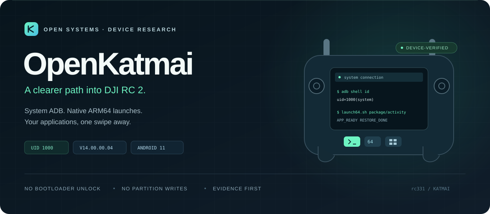
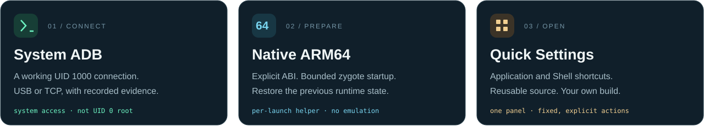
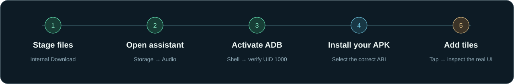

<p align="center">
  
</p>

<p align="center">
  <a href="docs/SETUP.md"><strong>Start here</strong></a> &nbsp; &middot; &nbsp;
  <a href="docs/64-BIT-APPS.md">ARM64 guide</a> &nbsp; &middot; &nbsp;
  <a href="docs/QUICK-SETTINGS.md">Quick Settings</a> &nbsp; &middot; &nbsp;
  <a href="docs/FINDINGS.md">Research findings</a> &nbsp; &middot; &nbsp;
  <a href="docs/TROUBLESHOOTING.md">Troubleshooting</a>
</p>

<p align="center">
  <a href="LICENSE"></a>
  
  
</p>

# OpenKatmai

A documented, working route to **system-UID ADB on DJI RC 2**, with native ARM64
launch preparation and application shortcuts in the notification panel. Built
around real-device observations, explicit prerequisites and reversible runtime
changes.

> [!IMPORTANT]
> This project targets **DJI RC 2 / rc331 firmware v10.00.0800 (2026.07.30)**.
> Android 11 internal build: **V14.00.00.04**. The working shell is
> **UID 1000 (`system`), not UID 0 root**. Compatibility with another firmware or
> every Android APK is not implied.

The connected remote reports `dji.prop.external_version=10.00.08.00`
(external firmware **v10.00.0800**) and `ro.build.id=V14.00.00.04`
(internal Android build). These are two identifiers for the same tested device;
Here, V14 identifies the internal Android build, not the external firmware version.
Support for other v10 builds has not been established.

<p align="center">
  
</p>

## Which tool matches my RC 2 firmware?

For **DJI RC 2 / rc331**, choose the tool matching your firmware below.
Versions use one format: **vXX.XX.XXXX (YYYY.MM.DD)**. Only entries with an
identified external firmware version are included.

| Firmware (release date) | Tool / GitHub | Access | Verification |
|---|---|---|---|
| **v10.00.0800 (2026.07.30)** | [hazim5-stack/OpenKatmai](https://github.com/hazim5-stack/OpenKatmai) | **System ADB (UID 1000)**, APK installation, tested ARM64 launch and Quick Settings shortcuts. **Not UID 0 root.** | Verified on this project's RC 2; see [findings](docs/FINDINGS.md#firmware-identity). |
| **v02.00.0300 (2023.12.21)** | [Dr-Muh/dji-adb](https://github.com/Dr-Muh/dji-adb) | Direct USB ADB **root shell**, as reported by its author. | Firmware listed in the upstream [tested versions](https://github.com/Dr-Muh/dji-adb#tested-rc2-firmware-versions); release date confirmed in [DJI release notes](https://dl.djicdn.com/downloads/DJI_RC_2/RN/20241015/DJI_RC_2_Release_Notes_EN.pdf). Not independently tested here on that release. |

Support for other firmware versions is not implied. System ADB and full root
are different capabilities.

## Choose your path

<table>
<tr>
<td width="33%" valign="top">
<h3>01 — First connection</h3>
<p>From internal Download to the factory assistant, Shell and a verified ADB connection.</p>
<p><a href="docs/SETUP.md"><strong>Follow the setup guide →</strong></a></p>
</td>
<td width="33%" valign="top">
<h3>02 — Run an ARM64 app</h3>
<p>Install with an explicit ABI, prepare the primary runtime and restore its previous state.</p>
<p><a href="docs/64-BIT-APPS.md"><strong>Open the ARM64 guide →</strong></a></p>
</td>
<td width="33%" valign="top">
<h3>03 — Build your panel</h3>
<p>Add app, ARM64 and Shell buttons with a small wrapper you can configure and build.</p>
<p><a href="docs/QUICK-SETTINGS.md"><strong>Create your shortcuts →</strong></a></p>
</td>
</tr>
</table>

## From a fresh connection to your first launch



### 1. Stage the files

Use a USB-C **data** cable and select **File transfer / MTP**. Copy the verified
`adbd-root` payload, `runroot.sh`, `restart.sh`, and your compatible original
factory-assistant APK into the remote's **internal Download** folder.

Obtain and hash-check the payload using [Payloads](payloads/README.md).
`/sdcard/Download` in these commands is internal shared storage; a removable SD
card is not required. Factory-assistant and ADB payload binaries are not included
in this repository.

### 2. Open the assistant and activate ADB

The owner-recorded route on this unit was **Storage → Audio → internal Download
→ assistant APK → Open → Shell command test**. Picker behavior can vary; the
[setup guide](docs/SETUP.md#3-openinstall-the-assistant-from-the-remote) explains
the exact route, Chinese UI labels and gray-file cases.

On the assistant's Shell page, send this command **once**:

```sh
sh /sdcard/Download/runroot.sh
```

The output is written to `Download/runroot-out.txt`. A blank Shell output area
alone is not a failure. Wait several seconds and check the computer.

### 3. Verify the connection

```powershell
adb devices -l
adb -s SERIAL shell id
# Expected: uid=1000(system) gid=1000(system) ...
```

Replace `SERIAL` with the remote's actual USB serial. USB is sufficient for
computer-side work. TCP access is also available through the remote's current
IP on port 5555; see [connection details](docs/SETUP.md#5-confirm-adb-on-the-computer).

> [!NOTE]
> The original `runroot.sh` schedules a return to stock ADB after **30 minutes**.
> `restart.sh` does not schedule a new timer, but does not cancel an older one.
> After each reboot, run `sh /sdcard/Download/restart.sh` from the assistant.
> [Understand the activation lifetime →](docs/SETUP.md#activation-lifetime)

### 4. Install and prepare an ARM64 application

Inspect the APK first. Replace the filename and component below with its actual
values; the example package is a placeholder.

```powershell
adb -s SERIAL install --abi arm64-v8a -r .\Example64.apk
adb -s SERIAL push .\scripts\launch64.sh /data/data/com.dpad.fuli/launch64.sh
adb -s SERIAL shell chmod 700 /data/data/com.dpad.fuli/launch64.sh
adb -s SERIAL shell sh /data/data/com.dpad.fuli/launch64.sh com.example.arm64app/com.example.arm64app.MainActivity
```

Before running the helper, compare its host/device hashes and confirm the target
package's `primaryCpuAbi=arm64-v8a` as shown in the [complete ARM64 guide](docs/64-BIT-APPS.md).
The helper checks prerequisites, temporarily starts primary zygote if needed,
opens the app, and restores the previous primary state. It leaves the running
secondary runtime and persistent policy unchanged.

```text
ATTEMPT=1
APP_READY
RESTORE_DONE
```

These markers establish a confirmed foreground launch and restoration, not the
health of every SDK, service or hardware connection. Apps that create additional
64-bit processes later may need further runtime handling.

### 5. Put your applications in Quick Settings

Configure and build the included [tile wrapper](src/quick-tiles), install it, and
register the desired services:

```powershell
adb -s SERIAL shell cmd statusbar add-tile org.openkatmai.tiles/.AppTileService
adb -s SERIAL shell cmd statusbar add-tile org.openkatmai.tiles/.Arm64TileService
adb -s SERIAL shell cmd statusbar add-tile org.openkatmai.tiles/.ShellTileService
adb -s SERIAL shell cmd statusbar expand-settings
```

The ordinary tile opens your configured package. The ARM64 tile performs runtime
preparation before launch. The Shell tile opens the command page through local
system ADB, with an assistant-menu fallback if that connection is unavailable.
**Opening Shell does not submit a command.**

The wrapper uses `127.0.0.1:5555`, so the clean daemon must already be active even
if the computer connects only through USB. Follow the [build, installation and
real-screen verification steps](docs/QUICK-SETTINGS.md); `add-tile` cannot register
a service before its wrapper APK is installed.

## What has actually been established

- **ADB:** USB and TCP connections reached a UID 1000 system shell using a clean
  AOSP daemon. Stock DJI adbd's production gate is documented separately.
- **ARM64:** a real ARM64 application installed with an explicit ABI and opened
  through ActivityManager. Primary zygote was restored to stopped; secondary
  remained running and policy remained `4`.
- **Panel shortcuts:** real on-device taps opened application and Shell UIs.
  The generic source here builds and passes APK signature/alignment checks;
  its placeholder target is not a separately tested application.
- **Boundaries:** no UID 0 root, bootloader unlock, eFuse operation or system
  partition write was needed. Universal app compatibility, complete SDK/hardware
  operation and automatic boot activation have not been established.

<details>
<summary><strong>Why developer mode alone does not fix stock ADB</strong></summary>

DJI's stock daemon checks production-state properties before the normal ADB
handshake. On the recorded build it returns without an authorization token,
leaving the computer at `offline`. Separate userlock and service-socket checks
also prevent a simple manually started copy from solving the problem.

OpenKatmai runs the hash-verified clean AOSP `adbd` from the factory assistant's
system UID. It does not replace or patch the stock system daemon.
[Read the findings and exact evidence →](docs/FINDINGS.md)

</details>

<details>
<summary><strong>Why the earlier “32-bit only” conclusion changed</strong></summary>

Minimal fixture APKs produced ABI errors, but those results did not justify a
universal PackageManager restriction. A real ARM64 APK later installed and
launched successfully with explicit ABI selection and primary zygote available.
The earlier blanket conclusion is retracted in the research record.
[Read the corrected ARM64 findings →](docs/FINDINGS.md#6-64-bit-app-support)

</details>

## Documentation library

- [First-time setup](docs/SETUP.md) — files, Storage/Audio route, assistant, Shell,
  connection verification, logs and reactivation after reboot.
- [64-bit applications](docs/64-BIT-APPS.md) — inspect, install, prepare, launch,
  restore and understand the compatibility limits.
- [Quick Settings](docs/QUICK-SETTINGS.md) — build and configure the wrapper,
  register tiles, verify real behavior, update and remove.
- [Troubleshooting](docs/TROUBLESHOOTING.md) — gray APKs, blank output, offline ADB,
  the 30-minute timer, ABI errors, helper markers and tile failures.
- [Findings](docs/FINDINGS.md) — daemon guards, architecture evidence and corrected
  runtime conclusions.
- [Root research status](docs/ROOT-STATUS.md) — current capability, experiments and
  the remaining linker-namespace blocker.
- [Technical reference](docs/REFERENCE.md) — the preserved original technical
  overview, device properties, everyday commands, Home configuration and cleanup.
- [Payload verification](payloads/README.md) — sources and SHA-256 identities.

## Project structure

```text
OpenKatmai/
├── assets/                 Custom SVG project artwork
├── docs/                   Setup, ARM64, tiles, evidence and troubleshooting
├── scripts/
│   ├── runroot.sh          First activation + 30-minute restoration timer
│   ├── restart.sh          Reactivate the existing daemon after reboot
│   ├── launch64.sh         Bounded ARM64 launch + previous-state restoration
│   └── sethome.sh          Optional Home configuration helper
├── src/
│   ├── quick-tiles/        Generic Android wrapper source and Windows build
│   └── agent.c             Historical UID 0 research source
├── payloads/README.md      Obtain and verify payloads; no binary distribution
└── SHA256SUMS.txt          Payload identities
```

## Operating boundaries

Keep the unauthenticated clean ADB endpoint on a trusted network. Use the verified
payload, select the correct device serial, and inspect commands before sending
them from the assistant. Preserve a known-good working setup before experimenting.

The documented workflow uses `/data` and internal shared storage. Do not write to
`/dev/block`, flash partitions, or unlock/re-lock the bootloader as part of this
procedure. Existing notes about DJI Fly updates and recovery are retained in the
[technical reference](docs/REFERENCE.md#9-warnings); do not treat an update as a
required setup step.

To remove the setup, remove custom tiles/APKs and unused helper files **while ADB
still works**, restore your preferred Home app if changed, then reboot. See the
[cleanup procedure](docs/REFERENCE.md#7-uninstall-back-to-100--stock).

## Credits

- [rc2-unlock-toolkit](https://github.com/456erddgr/rc2-unlock-toolkit) — source of
  the clean AOSP payload and earlier capability-bridge research.
- [dji-adb](https://github.com/Dr-Muh/dji-adb) — direct-USB handshake experiments.
- Independent RC 2 research — exact-binary analysis, production-gate evidence and
  real-device runtime validation.

Original project content is available under the [MIT License](LICENSE). DJI
binaries are not redistributed. DJI, DJI RC 2 and DJI Fly are trademarks of SZ DJI
Technology Co., Ltd. OpenKatmai is independent research and is not affiliated
with or endorsed by DJI.
