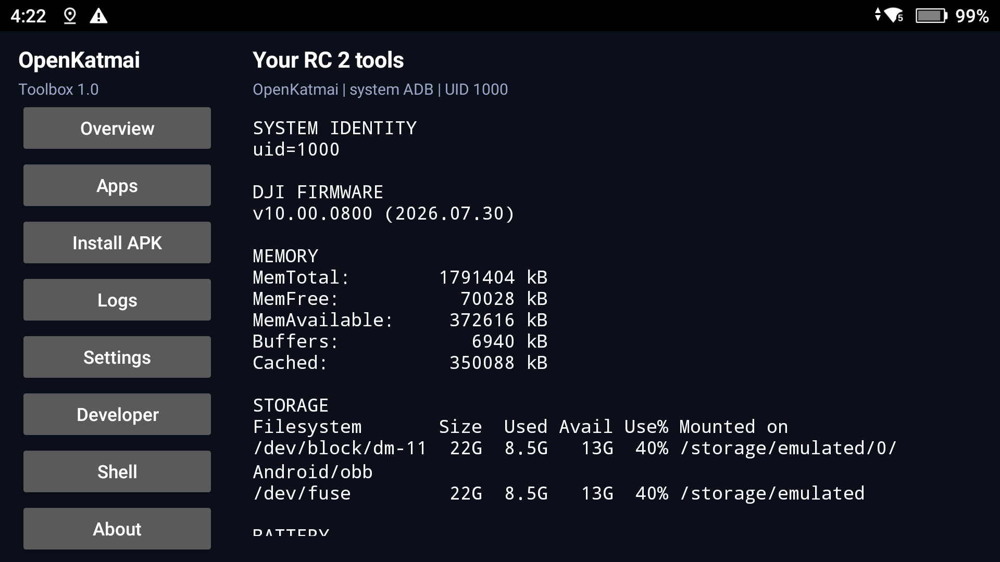

# OpenKatmai Toolbox 1.1.1

An optional on-device app manager for **DJI RC 2 firmware v10.00.0800 (2026.07.30)**.
It uses the existing OpenKatmai local ADB connection as **UID 1000 system**.
Installing Toolbox alone does not activate ADB or grant full root.



## Install or update Toolbox

Download [OpenKatmai-Toolbox.apk](https://github.com/hazim5-stack/OpenKatmai/releases/download/toolbox-v1.1.1/OpenKatmai-Toolbox.apk)
and compare it with that release's `SHA256SUMS.txt`. Activate ADB using
[First-time setup](SETUP.md), then install:

```powershell
adb -s SERIAL install -r .\OpenKatmai-Toolbox.apk
adb -s SERIAL shell am start -n org.openkatmai.toolbox/.MainActivity
adb -s SERIAL shell cmd statusbar add-tile org.openkatmai.toolbox/.ToolboxTileService
```

Replace `SERIAL` with the actual device serial. Version 1.1.1 updates earlier published
Toolbox APKs with the same signing key. Keep `127.0.0.1:5555` active even when your PC
uses USB, and reactivate OpenKatmai after each remote reboot.

## First-launch shortcut prompt

On first launch, a popup asks **Would you like me to add myself to the top bar?**
with **Yes**, **No** and **Do not show this again**. Arabic text is included for
Arabic-language devices.

- **Yes** adds the Toolbox tile through local system ADB and verifies registration.
  After success, the prompt is not repeated for an already-added tile.
- **No** leaves the top bar unchanged. Without the checkbox, the prompt can appear
  again on the next launch.
- The checkbox saves the suppression preference for either answer, including when
  a Yes attempt fails because ADB is unavailable. An unchecked failed Yes can retry
  on the next launch.
- Bulk cleanup resets the remembered tile-added state while preserving the user's
  Do not show this again choice.

The popup is shown before startup diagnostics, so an initial background request
cannot silently swallow a Yes click. Checkbox state survives activity recreation.
After opting out, the manual add-tile command above remains available.

## Download, install and add to the top bar

1. Copy a standalone APK to **internal Download** over USB file transfer.
2. Open Toolbox and tap **Download / Install** to browse APKs in that folder.
3. Select a file. Toolbox reads its package name, app label and native-library ABIs.
4. Review the app name, whether this updates an existing app, and ARM64 detection.
5. Tap **Install + add**. After installation, a named app tile appears in Quick Settings.

The chooser supports spaces and apostrophes in filenames. The folder's original
APK stays in Download until you explicitly select source deletion during removal.
The inspection cache is temporary. Toolbox verifies the inspected file's SHA-256
again on the staged installation copy, so changing the APK after confirmation
aborts installation. Split APK sets and arbitrary APK compatibility are not implied.

**Apps** also lets you open an existing app, add it to the top bar, or remove only
its shortcut. Apps already present before Toolbox managed them are recorded as
pre-existing and are preserved during bulk cleanup. Up to **24 managed app tiles**
are available. Re-adding the same app reuses its slot instead of making duplicates.
Non-launcher packages can install, but cannot receive a launch tile.

## Automatic ARM64 compatibility

Every app tile reads the installed package ABI. For `arm64-v8a`, it deploys and
hash-verifies the bundled `launch64.sh` as a dedicated Toolbox helper, temporarily
starts primary zygote when necessary, opens the app, and restores the previous
primary state. Secondary zygote and persistent policy are left unchanged. This is
the same bounded preparation approach used for FlyKML, generalized to the selected
app's launcher activity. Multiple launcher entries are handled without opening
Android's generic resolver. Standard apps use a normal activity launch.

The helper includes a short runtime-ready delay, hard process timeouts and a
watchdog. The compatibility task runs independently of its ADB connection and writes a
private temporary result file, which Toolbox polls through short raw-exec requests
and removes afterward. Launch results must include `APP_READY` and `RESTORE_DONE`.
**About** shows the last top-bar launch result. A successful app launch does not
establish aircraft/SDK connectivity or compatibility with every background process.

## Remove apps and clean up

**Remove apps** shows removable third-party packages. Confirming removal deletes
the app and its data and removes its managed top-bar tile. A separate checkbox
can delete its recorded source APK from Download. Source deletion requires the
original recorded SHA-256; a changed file is kept and reported.

**Clean up** first shows a review of recorded apps and actions. It:

- Removes the managed app tiles.
- Uninstalls apps newly installed through Toolbox, checking their first-install
  timestamp and signing identity before automatic removal.
- Preserves apps that existed before Toolbox managed them.
- Optionally deletes the recorded source APKs, with the same hash check.
- Removes Toolbox's own tile, dedicated helpers and inspection cache.
- Optionally uninstalls Toolbox **last**.

System packages, DJI Fly, the factory assistant and Toolbox are protected from
the ordinary app remover. The active Home launcher must be changed before it can
be uninstalled. Failed actions retain their journal entries for retry; bulk cleanup
does not uninstall Toolbox if an earlier action needs attention. A changed/replaced
app is not silently claimed as Toolbox-owned. The existing ADB activation, apps
and top-bar components created outside this companion are preserved.

On the tested build, the standard shell uninstall command has a null-caller-package
failure under UID 1000. The companion instead deploys a small hash-verified Java
helper that calls Android 11's package deletion API as system UID, and checks
package readback. It does not elevate to UID 0, patch Android or write partitions.
The helper's source is included under `src/toolbox/device/`.

## Other tools

Overview reads firmware, memory, storage, battery and runtime state. Logs reads a
bounded recent logcat snapshot. Settings, Developer and Shell open the corresponding
Android/factory-assistant pages. No command is submitted through Shell automatically.
No logs, device registration or telemetry are sent to project maintainers.
CPU/GPU tuning, fan control, Magisk and bootloader tools are not included.

## Build and attribution

Build on Windows with JDK 17+, Android platform 30 and build-tools 35.0.0:

```powershell
.\src\toolbox\build.ps1
```

Output: `src/toolbox/build/OpenKatmai-Toolbox.apk`. The build compiles the Android 11
uninstall helper and bundles it together with the ARM64 script. Generated helper
JARs and build output are ignored; source and build instructions are committed.
Keep your local signing key to sign future updates. Independently generated keys
differ from the published release key and cannot update that installed APK.

MIT-licensed UI components are adapted from
[RC2 Unlock Toolkit](https://github.com/456erddgr/rc2-unlock-toolkit).
See [attribution](../src/toolbox/NOTICE.md) and [license](../src/toolbox/UPSTREAM-LICENSE.txt).
The full license is also bundled in the APK. The separate package ID allows
Toolbox to coexist with the original upstream app.

## Validation

Live validation and the exact observed outcomes are recorded in
[Toolbox 1.1 validation](TOOLBOX-VALIDATION.md). Firmware
**v10.00.0900 (2026.10.20)** is a community-testing candidate, **not tested** here.

Host-only protocol and removal-policy checks (requires free host loopback port 5555):

```powershell
New-Item -ItemType Directory -Force .\src\toolbox\build\tests | Out-Null
javac --release 8 -d .\src\toolbox\build\tests .\src\toolbox\java\org\openkatmai\toolbox\LocalAdb.java .\src\toolbox\java\org\openkatmai\toolbox\Actions.java .\src\toolbox\java\org\openkatmai\toolbox\SafetyPolicy.java .\src\toolbox\tests\TransportTest.java
java -cp .\src\toolbox\build\tests org.openkatmai.toolbox.TransportTest
```

The host fixture does not connect to or mutate the RC 2.

### First-launch prompt host tests (1.1.1)

```powershell
javac --release 8 -d .\src\toolbox\build\tests .\src\toolbox\java\org\openkatmai\toolbox\TilePrompt.java .\src\toolbox\tests\TilePromptTest.java
java -cp .\src\toolbox\build\tests org.openkatmai.toolbox.TilePromptTest
```

This pure-Java test uses in-memory preferences and a fake tile action. It makes no
network connection. The 1.1.1 popup was checked programmatically and compiled, but
was not installed or tested on the owner's powered-off remote.
